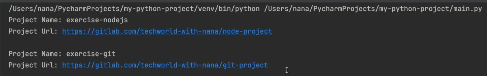

# API Request to GitLab

## Technologies used

Python, GitLab, IntelliJ, Git

## Project Description

- Write an application that talks to an API of an external application (GitLab) and lists all the public GitLab repositories for a specified user

## How to run

1. Create a GitLab personal access token with the `read_api` scope (**Settings > Access Tokens**).
2. Export it as an environment variable:

   ```bash
   export GITLAB_TOKEN="<your-token>"
   ```

3. Install the dependency and run the script:

   ```bash
   pip install requests
   python main.py
   ```

## Final output



*The script prints each GitLab project's name and repository URL.*
